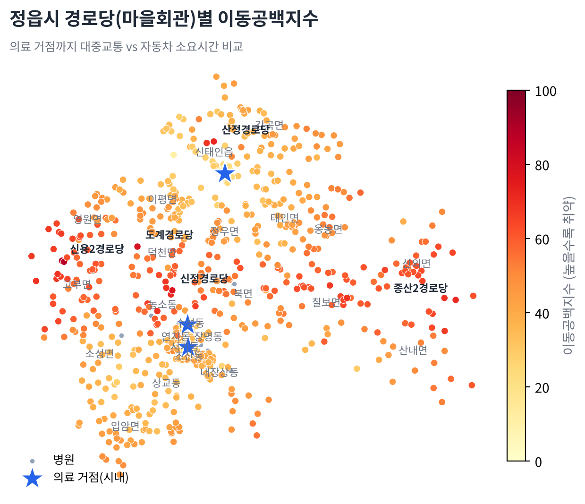
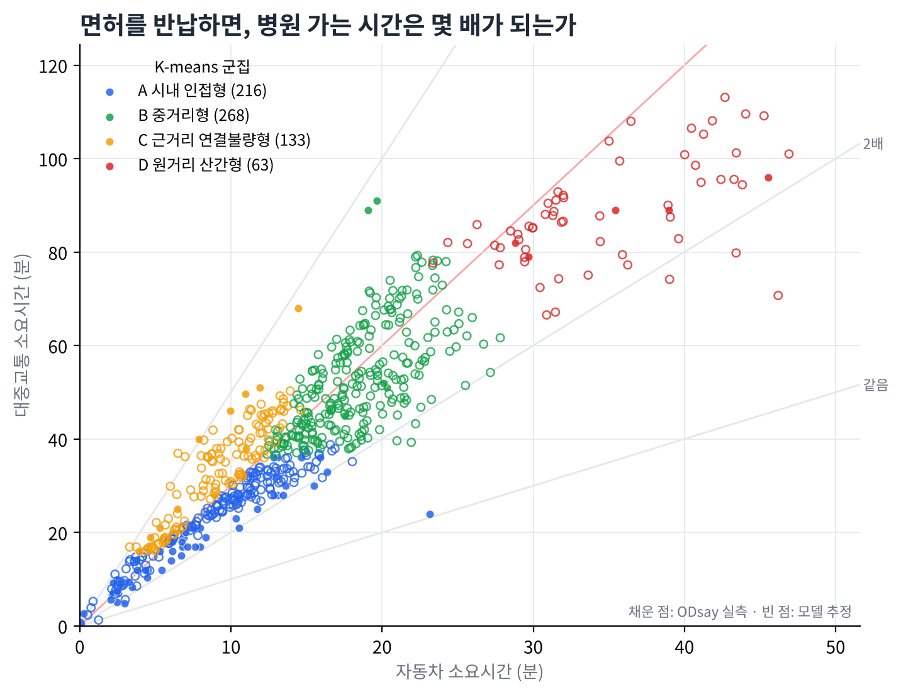

# 면허는 반납, 병원은 세 배 멀어진다

정읍시 경로당 680곳의 **이동공백지수**로 본 고령운전자 이동공백 분석
(한겨레 × 재단법인 숲과나눔 「AI와 함께하는 교통문제 해결을 위한 데이터 분석 공모전」, 팀 항로개척단)

## 무엇을 분석했나

"운전면허를 반납하면 병원 가는 시간이 몇 배가 되는가"를 마을(경로당) 단위로 측정했습니다.

1. **의료 거점 도출**: 어르신 주요 진료과(내과·정형외과·안과·재활의학과·치과·한의원) 병의원 131곳을 DBSCAN으로 군집화해 거점 3곳 도출
2. **마을 위치**: 정읍시 경로당 707곳 주소 → 좌표 변환 (680곳 성공)
3. **소요시간**: 경로당 → 가장 가까운 거점, 자동차(카카오모빌리티)와 대중교통(ODsay) 소요시간
4. **미실측 추정**: ODsay 실측 60곳으로 회귀모델 3종을 5겹 교차검증해 나머지 606곳 추정 (선형회귀, MAE 7.5분)
5. **이동공백지수**: 이동공백비(대중교통 ÷ 자동차) 60% + 추가시간 40%, 0~100점
6. **마을 유형**: K-means(k=4)로 시내 인접형 · 중거리형 · 근거리 연결불량형 · 원거리 산간형 분류

## 주요 결과

- 680곳 중 **271곳(39.9%)**은 대중교통이 자동차보다 3배 이상 걸림
- **255곳**은 대중교통이 30분 이상 더 걸림
- 평균 자동차 15.1분 vs 대중교통 42.7분




## 폴더 구성

| 경로 | 내용 |
|---|---|
| `collect_data.py` | 데이터 수집 (병원 → 좌표 변환 → 거점 군집화 → 소요시간) |
| `analyze.py` | 지수 산출, 회귀 추정, K-means, 그림 생성 |
| `flowchart.py` | 분석 알고리즘 흐름도 |
| `data/` | 수집 결과 (병원, 거점, 경로당 좌표, 소요시간) |
| `figures/` | 결과 그림, 순위표(`ranking.csv`), 인터랙티브 지도(`map_interactive.html`) |

## 실행 방법

```bash
pip install -r requirements.txt

# 분석만 다시 실행 (data 폴더에 수집 결과가 들어 있음)
python analyze.py data figures

# 데이터를 처음부터 수집하려면: keys.example.json을 keys.json으로 복사해 API 키 입력 후
python collect_data.py
```

수집에 필요한 키: 카카오 REST API 키(카카오맵 사용 설정 ON), ODsay API 키(서버 IP 등록), 공공데이터포털 인증키(병원 API를 쓸 때만. 병원 파일이 있으면 생략).
`keys.json`은 `.gitignore`에 포함되어 저장소에 올라가지 않습니다.

## 데이터 출처

- 전북특별자치도 정읍시_경로당 현황 (2024.12.31), 공공데이터포털
- 건강보험심사평가원_전국 병의원 및 약국 현황, 공공데이터포털
- 카카오 로컬 API, 카카오모빌리티 길찾기 API, ODsay 대중교통 길찾기 API

## 한계

- ODsay 무료 계정의 하루 호출 한도로 대중교통 실측은 74곳이며, 나머지는 회귀모델 추정값입니다.
- ODsay 소요시간은 배차 대기시간을 충분히 반영하지 않아 실제 공백은 더 클 수 있습니다.

## AI 활용

분석 기법으로 DBSCAN · K-means · 회귀모델(scikit-learn)을 사용했고, 분석 설계와 코드 작성에 생성형 AI(Claude)를 활용했습니다.
